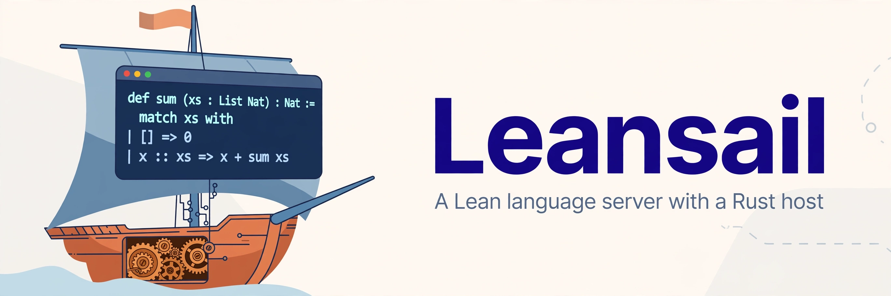
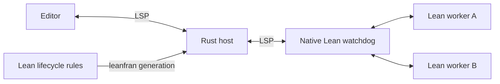

<p align="center">
  
</p>

<p align="center"><strong>A Lean language server with a Rust host and Lean-verified lifecycle rules</strong></p>

<p align="center">
  <a href="https://github.com/conao3/rust-leansail/actions/workflows/ci.yml"></a>
  <a href="LICENSE"></a>
  <a href="Cargo.toml"></a>
  <a href="lean-toolchain"></a>
  <a href="https://github.com/conao3/rust-leansail/stargazers"></a>
</p>

<p align="center">
  <a href="#install-and-run">Install and run</a> ·
  <a href="#editor-setup">Editor setup</a> ·
  <a href="#performance">Performance</a> ·
  <a href="#how-it-works">How it works</a> ·
  <a href="#compatibility-and-testing">Testing</a> ·
  <a href="#development">Development</a> ·
  <a href="docs/architecture.md">Architecture</a> ·
  <a href="https://github.com/conao3/lean-leanfran">leanfran</a> ·
  <a href="https://github.com/conao3/rust-lsp-touchstone">lsp-touchstone</a>
</p>

# Leansail

Leansail is a drop-in replacement for `lean --server` in Lean 4.35.0 projects. Your editor talks LSP to it the same way, and tests check that it returns the same responses as upstream Lean.

It answers the slow requests faster on large projects. On Mathlib, repeated document highlight, semantic tokens, completion and workspace symbol search take a fraction of the upstream time, the project index is ready sooner, and the server uses less memory. The rules for the LSP lifecycle, client capabilities and stale responses are written in Lean, proved there, and compiled into the Rust host with [leanfran](https://github.com/conao3/lean-leanfran). Tests compare its responses with upstream across all 59 upstream protocol entries, and real Emacs and Neovim sessions check the editor experience.

Leansail supports Lean 4.35.0 only. Its backend embeds `Lean.Server` from that release, so start it in Lean 4.35.0 projects. The Nix flake builds for x86_64-linux and aarch64-darwin, and CI runs on Linux.

## Highlights

Numbers below are medians for `IntegralEqImproper.lean` in Mathlib v4.35.0 with 3 documents open, on an Intel Core i5-8400 (6 cores). Ratios are upstream / Leansail, so higher is better for Leansail.

- Repeated document highlight: 672.346 ms vs 0.924 ms (727.37x).
- Repeated semantic tokens: 74.716 ms vs 3.963 ms (18.85x).
- Repeated completion: 322.236 ms vs 70.428 ms (4.58x).
- Repeated workspace/symbol: 850.690 ms vs 87.456 ms (9.73x).
- Project index ready after startup: 21418.880 ms vs 5519.296 ms (3.88x), with a persistent index cache.
- Total memory (PSS) after analyzing 3 documents: 3596.155 MiB vs 2526.203 MiB (1.42x).
- Same answers: all 3,432 response bodies from the benchmark match upstream.

See [Performance](#performance) for the trade-offs.

## Install and run

Leansail ships as a Nix flake. The package bundles the native backend and its matching Lean toolchain.

Install the `leansail` command:

```bash
nix profile add github:conao3/rust-leansail
```

On older Nix versions, the subcommand is `nix profile install`.

To run it without installing:

```bash
nix run github:conao3/rust-leansail -- server run-server
```

Start the server from the root of a Lean 4.35.0 project. It speaks LSP on stdio:

```bash
leansail server run-server
```

If the project has dependencies (for example Mathlib), let Lake supply their paths:

```bash
lake env leansail server run-server
```

## Editor setup

Leansail is verified with Emacs 31.1 / Eglot 1.24.31 and the built-in LSP client of Neovim 0.12.6. Put `leansail` on PATH and open a file in a Lean 4.35.0 project. With dependency libraries, change the commands below to `lake env leansail server run-server`.

### Emacs / Eglot

```elisp
(require 'eglot)
(define-derived-mode leansail-lean-mode prog-mode "Lean")
(add-to-list 'auto-mode-alist '("\\.lean\\'" . leansail-lean-mode))
(add-to-list 'eglot-server-programs
             '(leansail-lean-mode . ("leansail" "server" "run-server")))
(add-hook 'leansail-lean-mode-hook #'eglot-ensure)
(add-hook 'kill-emacs-hook #'eglot-shutdown-all)
```

Emacs 31's Flymake only diagnoses files in projects you trust. Add yours with `M-x customize-option RET trusted-content`.

| Feature | Command |
| --- | --- |
| Diagnostics list | `M-x flymake-show-buffer-diagnostics` |
| Hover | ElDoc |
| Go to definition | `M-.` |
| Completion | `C-M-i` |

If you have lean4-mode installed, register Eglot and the hook on `lean4-mode` instead of `leansail-lean-mode`.

To show the goal at point:

```elisp
(defun leansail-show-goal ()
  (interactive)
  (let ((goal (jsonrpc-request (eglot-current-server) :$/lean/plainGoal
                               (eglot--TextDocumentPositionParams))))
    (with-help-window "*Lean goal*"
      (princ (plist-get goal :rendered)))))
```

### Neovim / built-in LSP

```lua
vim.filetype.add({ extension = { lean = "lean" } })
vim.api.nvim_create_autocmd("FileType", {
  pattern = "lean",
  callback = function()
    vim.lsp.start({
      name = "leansail",
      cmd = { "leansail", "server", "run-server" },
      root_dir = vim.fs.root(0, { "lakefile.toml", "lakefile.lean", "lean-toolchain", ".git" }),
      exit_timeout = 10000,
    })
  end,
})
```

`exit_timeout` is how long (ms) Neovim waits for the `shutdown` response and `exit` when it quits. In Neovim 0.12.6 the default is `false`, which makes that wait 0.

| Feature | Command |
| --- | --- |
| Diagnostics list | `vim.diagnostic.setloclist()` |
| Hover | `K` |
| Go to definition | `vim.lsp.buf.definition()` |
| Completion | `C-x C-o` in insert mode |

To show the goal at point:

```lua
vim.api.nvim_create_user_command("LeanGoal", function()
  local client = assert(vim.lsp.get_clients({ bufnr = 0, name = "leansail" })[1])
  local params = vim.lsp.util.make_position_params(0, client.offset_encoding)
  client:request("$/lean/plainGoal", params, function(err, result)
    assert(not err, vim.inspect(err))
    if result and result.rendered then
      vim.lsp.util.open_floating_preview(vim.split(result.rendered, "\n"), "markdown", {})
    end
  end, 0)
end, {})
```

## Performance

Official Lean 4.35.0 `lean --server` and Leansail (release host with the native backend) run alternately on the same Mathlib v4.35.0 Lake workspace on helios (Intel Core i5-8400, 6 cores). Each session keeps 3 documents open and measures requests after analysis and index preparation finish. Each configuration runs 5 sessions. First requests have 5 samples each, and repeated requests have 50 samples each. Leansail loads a prebuilt persistent index, and every compared run requires a cache hit.

Medians for `IntegralEqImproper.lean`. Ratios are upstream / Leansail; above 1 means Leansail is faster or smaller.

| Item | Upstream | Leansail | Ratio |
| --- | ---: | ---: | ---: |
| Highlight, first (ms) | 673.635 | 117.852 | 5.72 |
| Highlight, repeated (ms) | 672.346 | 0.924 | 727.37 |
| Semantic tokens, repeated (ms) | 74.716 | 3.963 | 18.85 |
| Completion, repeated (ms) | 322.236 | 70.428 | 4.58 |
| workspace/symbol, repeated (ms) | 850.690 | 87.456 | 9.73 |
| hover, repeated (ms) | 1.364 | 1.445 | 0.94 |
| plainGoal, repeated (ms) | 1.446 | 1.573 | 0.92 |
| Startup to first non-empty diagnostics (ms) | 6884.395 | 7015.356 | 0.98 |
| Startup to project index ready (ms) | 21418.880 | 5519.296 | 3.88 |
| Total PSS right after analyzing 3 documents (MiB) | 3596.155 | 2526.203 | 1.42 |
| Total PSS after requests on 3 documents (MiB) | 3767.910 | 3126.693 | 1.21 |

Hover, plainGoal and time to first diagnostics stay close to upstream. Startup to index ready comes from separate sessions that don't open documents. For all 3 documents and all completed runs, the first and repeated response bodies and the completion resolve results match upstream.

The [full benchmark](docs/mathlib-benchmark.md#%E6%9C%AC%E5%AE%B6%E3%81%A8%E3%81%AE%E6%AF%94%E8%BC%83) has p95 values, references and definition, the other 2 documents, accepted and excluded runs, JSON, graphs and reproduction steps (in Japanese).

## How it works



- **Rust host.** Handles LSP framing, process supervision and the client lifecycle gate.
- **Lean rules compiled by leanfran.** `src/lifecycle.rs`, `src/capabilities.rs` and `src/recovery.rs` define the decision rules and theorems in Lean for the lifecycle, client capabilities, suppression of stale responses and worker recovery. The real forwarding path calls the Rust functions that leanfran generates from them.
- **Native backend.** `native/Main.lean` embeds upstream `Lean.Server` and keeps its watchdog, per-document workers, request handlers, widgets and RPC. It reuses the highlight index and semantic tokens responses of analyzed documents. Module names for the index come straight from the import array, and Lean theorems check that the result equals upstream's.

The native Watchdog manages per-file workers. This boundary stays in place based on a comparison of foreground p95 and PSS on 3 Mathlib documents with 6 cores. [docs/architecture.md](docs/architecture.md) defines the host's responsibilities and leanfran's decision rules.

## Compatibility and testing

- **Upstream protocol comparison.** `make check-acceptance` sends the same documents and requests to `lean --server` and Leansail and compares all 59 upstream protocol entries: 34 requests, 10 client notifications, 3 server→client requests, 2 server notifications and 10 Widget RPC calls. All 59 match.
- **Real editors.** `make check-editors` drives pinned Emacs / Eglot and Neovim through startup, diagnostics, hover, go to definition, completion, goal display, continuous typing, close and reopen, and exit, and compares the results with upstream.
- **LSP conformance.** The [lsp-touchstone](https://github.com/conao3/rust-lsp-touchstone) strict client checks a real session with 0 errors and 0 warnings on both sides.
- **Cancellation and fault recovery.** Tests kill real FileWorker and Watchdog processes and check that Leansail reports the right errors and recovers the worker.
- **Proofs.** `make check` checks 29 leanfran theorems, their audit with leanassay, and 6 native backend equivalence theorems.

[docs/verification.md](docs/verification.md) has the commands, result files, the editor comparison table, error codes and the lsp-touchstone findings. [docs/acceptance.md](docs/acceptance.md) has the per-entry protocol results.

## Development

```bash
nix develop
make build
target/debug/leansail server run-server \
  --backend "$PWD/native/.lake/build/bin/leansail-backend"
```

Before committing, run the full check and the package build:

```bash
nix develop --command make check
nix build
```

`audit/` runs [leanassay](https://github.com/conao3/lean-leanassay) on the generated functions called by Rust. `make check` fails when a mutant changes a tested result while satisfying every theorem, when a theorem's hypotheses receive no satisfying input, or when a function has no theorem that refutes a mutant.

`make check` builds the native backend and the Rust host, then runs format, Clippy, the Lean theorems, Rust unit tests, regression checks, `make check-acceptance` and `make check-editors`. CI runs `make check`, `nix build` and `make check-protocol`. `make bench-mathlib` and the other `bench-mathlib-*` targets measure performance on Mathlib; see [docs/mathlib-benchmark.md](docs/mathlib-benchmark.md).

When you change Lean definitions, commit `lean/` and `.leanfran/cache/` together. The pinned leanfran of the development environment generates them, and Rust builds that use the cache read the generated code.

## License

Apache-2.0. See [LICENSE](LICENSE) and [NOTICE](NOTICE).

## Related projects

- [leanfran](https://github.com/conao3/lean-leanfran) checks theorems about Lean definitions and compiles the definitions into Rust.
- [lsp-touchstone](https://github.com/conao3/rust-lsp-touchstone) is an LSP strict client and checking proxy that validates real sessions.
