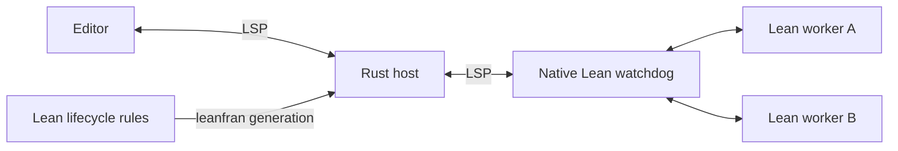

# Architecture

## Implemented boundary

Rust host は frame header を 64 KiB、本文を 64 MiB に制限し、通常の要求と現在の文書に対する応答を元の本文で転送する。transport は容量を制限した channel を使う。壊れた frame でセッションを終了し、クライアントの EOF で backend の標準入力を閉じる。5 秒以内に終了する backend を待ち、期限を超える場合はプロセスを終了する。Linux では backend に parent-death signal を設定する。native Watchdog がファイルごとの worker を隔離・管理する。

lifecycle が `exit` を受理したときは、元の frame を転送した後に backend の標準入力を閉じる。Lean 4.35.0 の Watchdog は `shutdown` 後の `params: {}` 付き `exit` を待機終了の条件に含めず、EOF で終了する。Eglot が送るこの形式でも backend と host を正常終了させる。

Lifecycle transitions come from the embedded Lean model. It determines whether
initialization, ordinary client requests, shutdown and exit are accepted.
Rust associates initialize and shutdown responses with their request IDs and
applies the generated transitions. Unrelated responses cannot advance the gate.
server からの要求は `initialize` で受け取った capability と照合する。`src/capabilities.rs` の Lean 定義が refresh の capability path、ファイル監視の動的登録の受付、転送・代理応答・拒否を決める。Rust は JSON を読み、登録の全 entry の判定を集約し、応答を元の要求の ID で backend へ返す。refresh の代理応答は `null`、未対応の動的登録の拒否は `-32601` である。対応済みの要求、通常の応答、通知、Lean 拡張と widget RPC は元の frame を転送する。

capability の定理は refresh の転送に対応宣言が必要なこと、未対応の refresh が代理応答になること、監視の登録に動的登録への対応が必要なこと、登録の許可と拒否、対象外の要求の転送を検査する。JSON の解釈、transport と backend 自体の正しさは証明の範囲に含めず、Rust の単体テストと host を起動する通信テストで検査する。

The model proves that ordinary requests require the running phase, that exit is
accepted from every phase, that the exited state is terminal, and that entry to
the running phase has an allowed predecessor. These are properties of this state
machine, not a proof of the entire server or the LSP specification.

Lean backend は完了した snapshot stream からハイライトの索引を作り、worker ごとに URI と文書の版に対応する 1 件を保持する。module 名は import の配列を直接参照する。4 件の定理で、直接参照、識別子、参照の収集、最終的な索引が上流の実装と等しいことを検査する。解析中と構文に固有のハイライトは上流の handler を使う。

`semanticTokens/full` は完了した応答の直列化済みの本文を worker ごとに 1 件保持する。URI と版を照合して再利用し、編集時は世代を増やして破棄する。完了時に要求を開始した世代と照合するため、古い処理が編集後に cache を再登録することも防ぐ。部分応答、refresh、上流の stateful handler の順序は保持する。キャンセルは cache hit と構築完了の両方で検査する。

これらは native Lean 内で完結する。Rust host は既存の leanfran 生成の規則を使う。Mathlib の比較計測とプロファイルの手順は [Mathlib の計測](mathlib-benchmark.md) が持つ。

## 要求の版と障害復旧

`src/recovery.rs` は開いている文書の版と、その文書の open・変更ごとに増える内部の識別子を記録する。要求には受付時の識別子を関連付け、close 後の reopen も区別する。返答時の判定は Lean の `responseDecision` を使い、明示的にキャンセルされた要求には `-32800`、文書が変わった要求には `-32801` を返す。JSON の URI・ID の解釈と記録は Rust、キャンセル・版の一致から返答の扱いを決める規則と 3 件の定理は Lean が担う。

現在の版に対する fatal な `$/lean/fileProgress` を受けたら、その文書を crash 状態として記録する。次の要求では Lean の `restartWorker` を呼ぶ。crash・open・request の条件を満たすと、host が同じ版に対する空文字の挿入を `didChange` として送り、その後に元の要求を送る。Watchdog は保有する文書から FileWorker を再起動する。判定を呼び出す経路と 3 件の定理を保持し、プロセスの操作とメッセージの配送を Rust で行う。

Watchdog の接続が `exit` の前に終了した場合、保留中の要求に `-32603` と `window/showMessage` のエラー通知を送り、host は終了コード 255 で終了する。クライアントは言語サーバー全体を再起動して文書を開く。Watchdog 内の索引・保留要求・RPC session を含む状態をセッション単位で再構築するための境界である。

Lean.Server の標準ライブラリのソース探索は実行ファイルからの相対パスを使う。開発用 backend の `.lake/build/src/lean` と Nix backend の `src/lean` は、同じ toolchain のソースを参照する。`lake env` が渡すプロジェクトの `LEAN_SRC_PATH` と併用する。type definition、module hierarchy、Widget の移動先も同じ探索先を使う。

## Using leanfran

Use leanfran actively for deterministic rules that benefit from an executable
specification shared by Lean and Rust: lifecycle transitions, document version
acceptance, stale-request decisions, cancellation state and scheduling policy.
Add each policy when the host actually needs it, together with the relevant
invariants and behavior tests. Keep OS I/O, threads and process control in Rust.

生成された runtime と native Lean はそれぞれのオブジェクトを所有する。host と backend の間は LSP の frame を転送し、索引の補助プロセスはパスと hash の JSON を受け渡す。native Lean のオブジェクトの解釈と所有は native Lean が担う。leanfran の Task は同期実行されるため、host の並行処理には Rust の thread を使い、転送経路では生成した純粋関数を呼ぶ。

## プロジェクト索引

`native/LeansailIndex.lean` は Watchdog の参照索引を `.ilean` から非同期に構築し、Lean の compacted region に保存する。保存は索引の準備完了とは別のタスクで行う。次のセッションでは、検証した領域を読み込み、worker の未保存の参照情報を上流と同じ規則で優先する。領域は Watchdog の存続中に保持する。ファイル変更の通知、参照要求、worker の起動と復旧は上流の Watchdog を使う。

Rust の `index-cache` 補助プロセスは `.ilean` の全パスと内容の SHA-256、toolchain、host と backend の SHA-256、Lake manifest、順序を保ったモジュールとソースの探索先、作業ディレクトリ、形式の版からキーを作る。保存前にもキーを照合し、payload と metadata をそれぞれ一時ファイルから rename する。読み込み時には payload の SHA-256 も検査する。`src/index_cache.rs` の Lean 定義と 5 件の定理が、入力のハッシュ・版・toolchain・payload のハッシュの一致を有効性の必要条件とし、全部が一致すると受理する。Rust は leanfran が生成した文字列と整数の比較を呼ぶ。ハッシュの計算、ファイル操作、compacted region の保存と読み込みは証明の範囲外で、内容変更と破損の検査、実際の LSP の比較で検証する。

保存先は `$XDG_CACHE_HOME/leansail/index/`、未設定時は `$HOME/.cache/leansail/index/` とする。`LEANSAIL_INDEX_CACHE_DIR` で指定できる。キャッシュの検証や保存の I/O エラーは標準エラーに記録し、`.ilean` による索引構築を継続する。backend を単独で起動した場合も `.ilean` を使う。worker ごとの解析状態とハイライト索引は文書の版に対応して保持する。追加の Rust 化は計測で遅いと分かった処理を対象にする。

`LEANSAIL_TRACE` に出力の prefix を指定すると、host と backend が PID ごとの JSONL に monotonic 時刻を記録する。段階別の計測では、固定 toolchain の Watchdog と FileWorker に計測点を加えた backend を `tests/mathlib_trace.py` でビルドする。上流ソースの hash と、置換箇所が一意であることを検査する。`no-cache` と `no-index` はこの計測用 backend だけの比較条件である。
