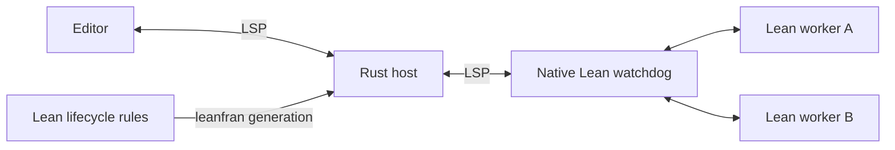

# Architecture

## Implemented boundary

The Rust host bounds frame headers to 64 KiB and bodies to 64 MiB, forwards
accepted message bodies unchanged, and uses a bounded channel for transport.
Malformed framing ends the session. EOF closes the backend's stdin; a backend
that does not stop within five seconds is terminated. On Linux the backend
receives a parent-death signal. The native watchdog retains upstream worker
isolation and cleanup.

Lifecycle transitions come from the embedded Lean model. It determines whether
initialization, ordinary client requests, shutdown and exit are accepted.
Rust associates initialize and shutdown responses with their request IDs and
applies the generated transitions. Unrelated responses cannot advance the gate.
Ordinary server responses, notifications, extensions and widget RPC remain
backend responsibilities.

The model proves that ordinary requests require the running phase, that exit is
accepted from every phase, that the exited state is terminal, and that entry to
the running phase has an allowed predecessor. These are properties of this state
machine, not a proof of the entire server or the LSP specification.

The Lean backend builds highlighting indexes from completed snapshot streams.
It retains one index per worker, keyed by document URI and version. Requests
during incomplete elaboration and syntax-specific highlights use the upstream
handler. This preserves the native Lean environment and metaprogram execution.

## Using leanfran

Use leanfran actively for deterministic rules that benefit from an executable
specification shared by Lean and Rust: lifecycle transitions, document version
acceptance, stale-request decisions, cancellation state and scheduling policy.
Add each policy when the host actually needs it, together with the relevant
invariants and behavior tests. Keep OS I/O, threads and process control in Rust.

The generated runtime and native Lean runtime own different objects. Messages
cross the boundary as framed bytes, never as shared Lean object pointers. The
current leanfran runtime executes Tasks synchronously; the host uses Rust threads
and calls only pure generated functions on the forwarding thread.

## Subsequent work

A Rust project-wide index and worker scheduler can replace backend services
through explicit interfaces. Decisions need measurements of startup, memory,
foreground request latency, cancellation and recovery on real projects. Keep
the Lean elaborator and tactic runtime in isolated workers while investigating
these changes. Profile remaining hot paths before choosing additional native
Rust implementations.
