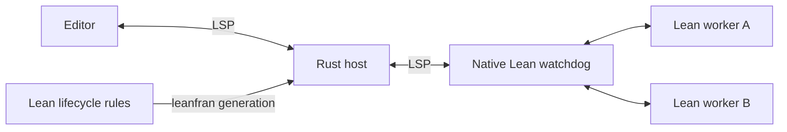

# Architecture

## Implemented boundary

Rust host は frame header を 64 KiB、本文を 64 MiB に制限し、通常の要求と現在の文書に対する応答を元の本文で転送する。transport は容量を制限した channel を使う。壊れた frame でセッションを終了し、クライアントの EOF で backend の標準入力を閉じる。5 秒以内に終了する backend を待ち、期限を超える場合はプロセスを終了する。Linux では backend に parent-death signal を設定する。native Watchdog がファイルごとの worker を隔離・管理する。

Lifecycle transitions come from the embedded Lean model. It determines whether
initialization, ordinary client requests, shutdown and exit are accepted.
Rust associates initialize and shutdown responses with their request IDs and
applies the generated transitions. Unrelated responses cannot advance the gate.
server からの要求は `initialize` で受け取った capability と照合する。`src/capabilities.rs` の Lean 定義が refresh の capability path、ファイル監視の動的登録の受付、転送・代理応答・拒否を決める。Rust は JSON を読み、登録の全 entry の判定を集約し、応答を元の要求の ID で backend へ返す。refresh の代理応答は `null`、未対応の動的登録の拒否は `-32601` である。対応済みの要求、通常の応答、通知、Lean 拡張と widget RPC は元の frame を転送する。

capability の定理は refresh の転送に対応宣言が必要なこと、未対応の refresh が代理応答になること、監視の登録に動的登録への対応が必要なこと、登録の許可と拒否、対象外の要求の転送を検査する。JSON の解釈、transport と backend 自体の正しさは証明の範囲に含めず、Rust の単体テストと host を起動する通信テストで検査する。

The model proves that ordinary requests require the running phase, that exit is
accepted from every phase, that the exited state is terminal, and that entry to
the running phase has an allowed predecessor. These are properties of this state
machine, not a proof of the entire server or the LSP specification.

The Lean backend builds highlighting indexes from completed snapshot streams.
It retains one index per worker, keyed by document URI and version. Requests
during incomplete elaboration and syntax-specific highlights use the upstream
handler. This preserves the native Lean environment and metaprogram execution.

## 要求の版と障害復旧

`src/recovery.rs` は開いている文書の版と、その文書の open・変更ごとに増える内部の識別子を記録する。要求には受付時の識別子を関連付け、close 後の reopen も区別する。返答時の判定は Lean の `responseDecision` を使い、明示的にキャンセルされた要求には `-32800`、文書が変わった要求には `-32801` を返す。JSON の URI・ID の解釈と記録は Rust、キャンセル・版の一致から返答の扱いを決める規則と 3 件の定理は Lean が担う。

現在の版に対する fatal な `$/lean/fileProgress` を受けたら、その文書を crash 状態として記録する。次の要求では Lean の `restartWorker` を呼ぶ。crash・open・request の条件を満たすと、host が同じ版に対する空文字の挿入を `didChange` として送り、その後に元の要求を送る。Watchdog は保有する文書から FileWorker を再起動する。判定を呼び出す経路と 3 件の定理を保持し、プロセスの操作とメッセージの配送を Rust で行う。

Watchdog の接続が `exit` の前に終了した場合、保留中の要求に `-32603` と `window/showMessage` のエラー通知を送り、host は終了コード 255 で終了する。クライアントは言語サーバー全体を再起動して文書を開く。Watchdog 内の索引・保留要求・RPC session を含む状態をセッション単位で再構築するための境界である。

Lean.Server の標準ライブラリのソース探索は実行ファイルからの相対パスを使う。開発用 backend の `.lake/build/src/lean` と Nix backend の `src/lean` は、同じ toolchain のソースを参照する。`lake env` が渡すプロジェクトの `LEAN_SRC_PATH` と併用する。type definition、module hierarchy、Widget の移動先も同じ探索先を使う。

## Using leanfran

Use leanfran actively for deterministic rules that benefit from an executable
specification shared by Lean and Rust: lifecycle transitions, document version
acceptance, stale-request decisions, cancellation state and scheduling policy.
Add each policy when the host actually needs it, together with the relevant
invariants and behavior tests. Keep OS I/O, threads and process control in Rust.

The generated runtime and native Lean runtime own different objects. Messages
cross the boundary as framed bytes, never as shared Lean object pointers. The
current leanfran runtime executes Tasks synchronously; the host uses Rust threads
and calls only pure generated functions on the forwarding thread.

## Subsequent work

A Rust project-wide index and worker scheduler can replace backend services
through explicit interfaces. Decisions need measurements of startup, memory,
foreground request latency, cancellation and recovery on real projects. Keep
the Lean elaborator and tactic runtime in isolated workers while investigating
these changes. Profile remaining hot paths before choosing additional native
Rust implementations.
