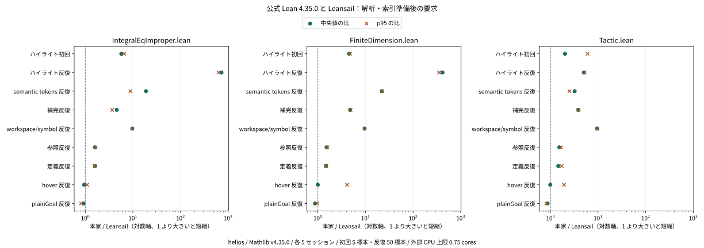

# Mathlib の計測

`make bench-mathlib` は Mathlib の実ファイルを開き、LSP の要求、編集後の解析、プロセス別 RSS を計測する。通常の `make check` と CI は小さい文書による機能の比較を実行する。Mathlib の依存と計測結果は `target/` に生成する。

## 本家との比較

IntegralEqImproper.lean の中央値の本家比は、ハイライト初回 5.72 倍、反復 727.37 倍、semantic tokens 反復 18.85 倍、補完反復 4.58 倍、workspace/symbol 反復 9.73 倍である。hover は 0.94 倍、plainGoal は 0.92 倍で、要求ごとの時間を表に示す。

公式 `lean --server` と、master の `2fc5678` の release host・native backend を、同じ回の計測で比較する。サーバー実装は `f618e81` と同じである。両構成に公式 Lean 4.35.0（git hash `eb6cafb7290e8bd5f2937522d8d804f58f02bafc`）と、同じ Mathlib v4.35.0（`56a005855ea17e0b0958f73ec801ae140b0a1679`）の Lake workspace を使う。backend は `native/` のソースをその公式 toolchain でビルドする。

計測ホストは helios（Intel Core i5-8400、6 cores）。各反復の実行順は本家→Leansail、Leansail→本家を交互にする。OS のファイルキャッシュを維持し、開始前 2 秒間とセッション全体の外部 CPU が 0.75 cores 以下の回を採用する。見送り・完走後の負荷除外・中断をそれぞれ記録する。

3 文書を順番に開き、全ての `waitForDiagnostics` と、プロジェクト・文書ごとの `$/lean/waitForILeans` が完了してから要求を測る。要求時は 3 文書とも開いた状態である。ハイライトを各文書への最初の要求にし、解析完了後の初回を独立に集計する。その他の反復も、最初の要求に続く 10 回を対象にする。workspace/symbol の検索語は `aecover_ball`。各セッションで同じ検索を文書ごとに実行する。

起動から最初の非空診断までは最初の文書（IntegralEqImproper.lean）で測る。索引準備時間は文書を開かない独立セッションで、起動から `$/lean/waitForILeans {}` の応答までを測る。Lean 4.35.0 の Watchdog はこの要求の待機中に要求処理を止めるため、診断時間と別のセッションで評価する。

Leansail は専用の永続索引を作成し、比較の全完走回で cache hit を確認する。初回の作成 1 回は、起動から検索に使えるまで 32427.254 ms、保存完了まで 60619.046 ms、外部 CPU は 0.302 cores（採用判定: true）。初回作成の採用 / 負荷除外 / 開始前の見送り / 中断は 1 / 0 / 28 / 0 回。初回作成はこの 1 標本を示す。

値は中央値 / p95。時間の単位は ms、PSS は MiB。倍率は本家 / Leansail を中央値と p95 それぞれで計算し、1 より大きい値が Leansail の短縮・削減を表す。初回とセッションの指標は各 5 標本、反復は各文書・各要求 50 標本。p95 は生の標本から nearest rank で計算し、5 標本の p95 は最大値になる。セッション内の反復を含む分布であり、独立なセッション数は各 5 である。

PSS は同じ時点の全子プロセス（本家は Watchdog と 3 workers、Leansail はそれらと Rust host）を合算する。解析・索引準備直後と、全要求を終えた時点を分ける。100 ms 間隔の時系列とプロセス別の値も JSON に保存する。

全完走回の 3 文書・8 要求について、初回と全反復の 3,432 本文が本家と一致する。オブジェクトのキーを整列し、配列の順序を保った JSON の SHA-256 を比較する。`twice` の completionItem/resolve も一致する。診断通知は Tactic.lean の警告 2 件と情報 1 件の順序を正規化すると内容が一致する。追加の受信ログから 2 通りの配列と hash を照合し、本文の代表値も JSON に保存する。各構成・反復の本文の代表値は `target/*.responses.json`、比較した hash・標本・採用判定・実行ファイルとソースの指紋は [mathlib-upstream-comparison.json](mathlib-upstream-comparison.json) が持つ。



各文書の倍率を同じ対数軸で表示し、中央値と p95 を分ける。基準線は 1 倍である。

### IntegralEqImproper.lean

| 項目 | 本家 中央値 / p95 | Leansail 中央値 / p95 | 倍率 中央値 / p95 |
| --- | ---: | ---: | ---: |
| ハイライト初回 | 673.635 / 794.671 | 117.852 / 121.331 | 5.72 / 6.55 |
| ハイライト反復 | 672.346 / 694.872 | 0.924 / 1.094 | 727.37 / 634.90 |
| semantic tokens 反復 | 74.716 / 81.904 | 3.963 / 9.207 | 18.85 / 8.90 |
| 補完反復 | 322.236 / 360.081 | 70.428 / 97.846 | 4.58 / 3.68 |
| workspace/symbol 反復 | 850.690 / 871.502 | 87.456 / 89.395 | 9.73 / 9.75 |
| 参照反復 | 20.872 / 23.427 | 13.106 / 14.219 | 1.59 / 1.65 |
| 定義反復 | 21.493 / 22.622 | 13.333 / 14.388 | 1.61 / 1.57 |
| hover 反復 | 1.364 / 1.713 | 1.445 / 1.564 | 0.94 / 1.10 |
| plainGoal 反復 | 1.446 / 1.751 | 1.573 / 2.135 | 0.92 / 0.82 |

### FiniteDimension.lean

| 項目 | 本家 中央値 / p95 | Leansail 中央値 / p95 | 倍率 中央値 / p95 |
| --- | ---: | ---: | ---: |
| ハイライト初回 | 294.766 / 312.369 | 65.228 / 65.880 | 4.52 / 4.74 |
| ハイライト反復 | 288.780 / 296.347 | 0.694 / 0.842 | 416.04 / 351.85 |
| semantic tokens 反復 | 38.285 / 45.192 | 1.736 / 2.003 | 22.05 / 22.56 |
| 補完反復 | 283.781 / 402.643 | 59.541 / 82.585 | 4.77 / 4.88 |
| workspace/symbol 反復 | 844.978 / 876.922 | 88.049 / 91.592 | 9.60 / 9.57 |
| 参照反復 | 19.186 / 21.116 | 12.610 / 13.252 | 1.52 / 1.59 |
| 定義反復 | 20.259 / 21.380 | 13.614 / 14.324 | 1.49 / 1.49 |
| hover 反復 | 1.491 / 6.844 | 1.495 / 1.660 | 1.00 / 4.12 |
| plainGoal 反復 | 3.490 / 4.004 | 4.009 / 4.165 | 0.87 / 0.96 |

### Tactic.lean

| 項目 | 本家 中央値 / p95 | Leansail 中央値 / p95 | 倍率 中央値 / p95 |
| --- | ---: | ---: | ---: |
| ハイライト初回 | 2.936 / 9.129 | 1.454 / 1.520 | 2.02 / 6.00 |
| ハイライト反復 | 1.993 / 3.285 | 0.396 / 0.636 | 5.03 / 5.16 |
| semantic tokens 反復 | 3.101 / 4.046 | 0.963 / 1.613 | 3.22 / 2.51 |
| 補完反復 | 262.081 / 355.528 | 68.030 / 91.967 | 3.85 / 3.87 |
| workspace/symbol 反復 | 846.395 / 871.173 | 88.022 / 91.333 | 9.62 / 9.54 |
| 参照反復 | 19.093 / 21.914 | 12.484 / 13.176 | 1.53 / 1.66 |
| 定義反復 | 19.667 / 25.430 | 13.502 / 14.825 | 1.46 / 1.72 |
| hover 反復 | 1.205 / 2.719 | 1.216 / 1.407 | 0.99 / 1.93 |
| plainGoal 反復 | 1.086 / 1.219 | 1.248 / 1.477 | 0.87 / 0.83 |

### 起動と 3 文書の PSS

| 項目 | 本家 中央値 / p95 | Leansail 中央値 / p95 | 倍率 中央値 / p95 |
| --- | ---: | ---: | ---: |
| 起動から最初の非空診断 | 6884.395 / 10684.064 | 7015.356 / 7273.548 | 0.98 / 1.47 |
| 起動からプロジェクト索引準備 | 21418.880 / 21545.757 | 5519.296 / 5563.834 | 3.88 / 3.87 |
| 3 文書解析直後の全 PSS | 3596.155 / 3604.026 | 2526.203 / 2528.910 | 1.42 / 1.43 |
| 3 文書要求実行後の全 PSS | 3767.910 / 3781.936 | 3126.693 / 3139.848 | 1.21 / 1.20 |

| 計測 | 構成 | 採用 | 負荷除外 | 開始前の見送り | 中断 |
| --- | --- | ---: | ---: | ---: | ---: |
| 3 文書 | 本家 | 5 | 3 | 3 | 0 |
| 索引のみ | 本家 | 5 | 1 | 0 | 0 |
| 3 文書 | Leansail | 5 | 0 | 0 | 0 |
| 索引のみ | Leansail | 5 | 0 | 0 | 0 |

### 本家比較の再現手順

Linux の開発環境を使い、グラフの描画には Harano Aji Gothic を用意する。公式 toolchain と Mathlib の準備は「再現手順」に従う。初回作成には新しい `index_cache_dir` を指定する。

```bash
toolchain_prefix="$(nix shell nixpkgs#elan --command elan run leanprover/lean4:v4.35.0 lean --print-prefix)"
index_cache_dir="$PWD/target/upstream-comparison-cache"
nix develop --command cargo build --release -j 4
nix develop --command bash -c '
  export PATH="$1/bin:$PATH" LEAN_SYSROOT="$1"
  python3 -c '\''import sys; sys.path.insert(0, "tests"); from mathlib import build_backend; print(build_backend())'\''
' bash "$toolchain_prefix"
backend="$PWD/target/mathlib-backend/.lake/build/bin/leansail-backend"
nix develop --command python3 tests/mathlib_index_prime.py \
  --toolchain "$toolchain_prefix" --backend "$backend" \
  --server leansail --index-cache-dir "$index_cache_dir" \
  --samples 1 --repetitions 1 --wait-idle \
  --output target/upstream-comparison-prime.json
for scenario in documents index; do
  extra=()
  if [ "$scenario" = index ]; then extra=(--startup-only); fi
  nix develop --command make bench-mathlib-upstream \
    BENCH_ARGS="--toolchain $toolchain_prefix --backend $backend --index-cache-dir $index_cache_dir --require-cache-hit --server upstream --server leansail --samples 10 --repetitions 5 --edits 2 --wait-idle --resume ${extra[*]} --output target/upstream-comparison-$scenario.json"
done
nix develop --command python3 tests/mathlib_diagnostics.py \
  --toolchain "$toolchain_prefix" --backend "$backend" \
  --index-cache-dir "$index_cache_dir" --server upstream --server leansail \
  --samples 1 --repetitions 1 --edits 2 --wait-idle \
  --output target/upstream-comparison-diagnostics.json
nix develop --command python3 tests/mathlib_upstream_report.py \
  target/upstream-comparison-documents.json \
  --index target/upstream-comparison-index.json \
  --prime target/upstream-comparison-prime.json \
  --diagnostics-reference target/upstream-comparison-diagnostics.json \
  --output docs/mathlib-upstream-comparison.json \
  --markdown target/upstream-comparison-tables.md \
  --chart docs/mathlib-upstream-comparison.svg
```

集計は、各構成 5 セッション以上の採用、文書と索引の計測の host/backend・ホスト・toolchain の一致、全応答の一致、全 Leansail セッションの cache hit を検査する。`--resume` は採用済みの回を再利用し、負荷による見送りと除外は保存したまま不足分を実行する。

## 再現手順

Linux と公式 Lean 4.35.0 の toolchain を使う。Mathlib は v4.35.0 の commit `56a005855ea17e0b0958f73ec801ae140b0a1679` に固定する。比較する `lean --server` と native backend は同じ toolchain の compiler、runtime、標準ライブラリを使い、host は release ビルドを使う。

```bash
nix shell nixpkgs#elan --command elan toolchain install leanprover/lean4:v4.35.0
toolchain_prefix="$(nix shell nixpkgs#elan --command elan run leanprover/lean4:v4.35.0 lean --print-prefix)"
nix develop --command make bench-mathlib \
  BENCH_ARGS="--prepare --toolchain $toolchain_prefix --samples 10 --repetitions 5 --edits 2 --wait-idle --output target/mathlib-results.json"
```

`--prepare` は小さい Lake プロジェクトを作り、固定した Mathlib を依存に加える。[Mathlib の cache コマンド](https://github.com/leanprover-community/mathlib4/blob/v4.35.0/Cache/README.md) の `lake exe cache get` で Mathlib 全体とその依存を取得し、import の検査と対象ごとの `lake setup-file` を済ませる。`--prepare-only` はここまでを実行する。以降は `--prepare` を省略して同じ workspace を再利用する。計測環境は約 7.3 GiB、プロジェクトと依存の `.ilean` は 9,049 本である。

Nix の Lean 4.35.0 は git hash が空で、同梱する leantar は 0.1.19 である。公式 toolchain は git hash `eb6cafb7290e8bd5f2937522d8d804f58f02bafc` と leantar 0.1.20 を持ち、公式 Mathlib キャッシュを利用できる。スクリプトは compiler の git hash を検査する。`--toolchain` はキャッシュの取得、Lake の準備、backend のビルド、両サーバーの実行に適用する。通常の Nix 配布物は `nix build` で検証する。

native backend のソースは `native/` から `target/mathlib-backend/` にコピーしてビルドする。`--backend` で比較したい保存済みの backend を指定できる。改修前を保存する場合は、実行ファイルの相対位置 `../src/lean` に同じ toolchain のソースへの symlink も作る。

## シナリオ

| 対象                                                                                                                                                                             |                             規模 | 選択の理由                                                         |
| -------------------------------------------------------------------------------------------------------------------------------------------------------------------------------- | -------------------------------: | ------------------------------------------------------------------ |
| [IntegralEqImproper.lean](https://github.com/leanprover-community/mathlib4/blob/56a005855ea17e0b0958f73ec801ae140b0a1679/Mathlib/MeasureTheory/Integral/IntegralEqImproper.lean) |   77,968 bytes、直接 import 4 本 | この版の Mathlib で最大のソース。積分の証明を再 elaboration する。 |
| [FiniteDimension.lean](https://github.com/leanprover-community/mathlib4/blob/56a005855ea17e0b0958f73ec801ae140b0a1679/Mathlib/Topology/Algebra/Module/FiniteDimension.lean)      |  40,074 bytes、直接 import 14 本 | import が多く、実際の証明を持つ。                                  |
| [Tactic.lean](https://github.com/leanprover-community/mathlib4/blob/56a005855ea17e0b0958f73ec801ae140b0a1679/Mathlib/Tactic.lean)                                                | 18,296 bytes、直接 import 397 本 | 多数の tactic を import する。                                     |

3 文書を順番に開き、最後まで開いた状態にする。ディスク上の Mathlib ソースをそのまま読み、末尾に小さい `twice` の定義、証明、`#check` を追加した未保存の文書を送る。hover、定義、参照、ハイライト、補完はこの共通の識別子、plainGoal はその証明の位置で測る。semantic tokens は Mathlib のソース全体が対象である。参照検索の件数は開いた文書と非同期に読み込む `.ilean` に依存する。

`didOpen` 後の空でない最初の `publishDiagnostics` と、`waitForDiagnostics` の応答までを別々に測る。起動からの時間は最初の文書の診断までとする。初期化応答の時間も保存する。要求ごとに初回と、続く `--samples` 回を記録する。

編集は UTF-16 の範囲を持つ増分通知で、1 文字の空白の挿入と削除を交互に送る。`tail` は末尾に追加した証明、`early` は実ソース内で最初に見つかる `by` の直後を編集する。`Tactic.lean` の `early` は実ソース直後である。各編集は `waitForDiagnostics` の完了まで測り、位置と標本を JSON に保存する。

## 集計と負荷

反復ごとに新しいサーバーを起動し、実行順を交互にする。OS のファイルキャッシュは維持する。初回要求と反復要求、最初の文書と追加の文書を分けて比較する。中央値と p95 は元の標本から計算し、p95 は nearest rank を使う。

Linux の `/proc` を 100 ms 間隔で読み、host、Watchdog、FileWorker、Lake の準備プロセスを区別する。プロセスごとの RSS 最大値と、同時点で合算した RSS の最大値を保存する。RSS には共有ページもプロセスごとに含まれるため、合算は物理メモリの専有量とは異なる。

開始前の 2 秒間とセッション中に他プロセスの CPU 使用量を検査する。既定の上限は 0.75 cores。上限を超えた回は `accepted: false` として保存し、`--resume` で成功済みの回を再利用しながら再計測できる。プロファイルの回は通常の性能表と分ける。

`--wait-idle` は負荷による見送りと除外の後に自動で再試行する。間隔は `--retry-delay` (既定 30 秒)、各条件・各反復の試行上限は `--max-attempts` (既定 200 回) で指定する。機能上の失敗はエラーとして停止する。開始前の見送りもサーバー別に JSON に保存する。再開時はホスト、シナリオ、実行ファイルの hash、標本数と負荷基準を照合し、集計時にも異なるホストの標本を拒否する。

改善前の保存済み backend は `--before-backend` で指定する。`--server upstream --server before --server leansail` を併用すると、3 条件を反復ごとに交互に実行する。改善前のソースは `git show 1fa2f5a:native/Main.lean` と `git show 1fa2f5a:native/lakefile.toml` から取得し、同じ公式 toolchain で `lake build` する。実行ファイルの `../src/lean` をその toolchain のソースへ向ける。保存した実行ファイルと比較対象の hash は結果 JSON に含む。

3 条件を揃える再現コマンドは次のとおり。`toolchain_prefix` は「再現手順」の値を使う。

```bash
nix develop --command bash -c '
  set -euo pipefail
  export PATH="$1/bin:$PATH" LEAN_SYSROOT="$1"
  mkdir -p target/mathlib-before-backend
  git show 1fa2f5a:native/Main.lean > target/mathlib-before-backend/Main.lean
  git show 1fa2f5a:native/lakefile.toml > target/mathlib-before-backend/lakefile.toml
  lake -d target/mathlib-before-backend build
  mkdir -p target/mathlib-before-backend/.lake/build/src
  ln -sfn "$1/src/lean" target/mathlib-before-backend/.lake/build/src/lean
' bash "$toolchain_prefix"
nix develop --command make bench-mathlib \
  BENCH_ARGS="--prepare --toolchain $toolchain_prefix --before-backend target/mathlib-before-backend/.lake/build/bin/leansail-backend --server upstream --server before --server leansail --samples 10 --repetitions 5 --edits 2 --wait-idle --resume --output target/mathlib-remeasure.json"
```

## 補完

`textDocument/completion` は native Lean 内で、import した定数（ヘッダー宣言）の検索結果を worker ごとに 1 件再利用する。補完文字列、現在の名前空間、除外を含む `open`、モジュール名、末尾のドットを照合し、上流と同じ順序の宣言名と表示名を保持する。ローカル宣言、局所変数、別名、キーワード、名前空間は各要求の環境から計算し、URI、位置、補完情報の番号を付けて返す。`reuseHeaderMatches_eq` が検索結果の再利用と再計算の同値性を検査する。

改善前は `ddd558d`、改善後は [`9025a84`](https://github.com/conao3/rust-leansail/commit/9025a84715cd01400f838b4263506177f2399c97)。公式 Lean 4.35.0、Mathlib v4.35.0、helios の同じ release host を使う。両 backend の永続索引を準備してから、通常計測と 3 文書の並列解析を改善前後で各 5 セッション採用する。外部 CPU の上限は開始前の 2 秒間とセッション中の平均で 0.75 cores。他セッションのプロセスを維持し、除外と見送りを保存して不足分を `--resume` で再開する。[補完の集計と全標本](https://github.com/conao3/rust-leansail/blob/master/docs/mathlib-completion-results.json) が実行ファイルの SHA-256、採用判定、要求時間、応答の hash を持つ。

### 通常計測

値は中央値 / p95（ms）。解析完了後の初回は各文書 5 標本、反復は各文書 15 標本である。各セッションで初回と後続 3 回を分ける。

| 文書                    |        改善前・初回 |       改善後・初回 |      改善前・反復 |     改善後・反復 |
| ----------------------- | ------------------: | -----------------: | ----------------: | ---------------: |
| IntegralEqImproper.lean |  981.382 / 1057.237 |  913.456 / 969.452 | 322.921 / 355.756 |  70.225 / 75.580 |
| FiniteDimension.lean    |  969.839 / 1000.259 |  841.340 / 862.009 | 286.276 / 351.625 | 60.254 / 247.513 |
| Tactic.lean             | 1058.549 / 1101.019 | 997.892 / 1030.294 | 265.261 / 291.478 |  72.636 / 84.768 |

### 並列解析

同じ 3 文書を保持し、積分ファイルの末尾を編集した直後に hover、補完、診断完了を要求する。背景の 2 文書が解析済みの条件と再解析中の条件を交互に各 3 回測る。各条件 5 セッション、15 標本で、値は編集通知から補完受信までの中央値 / p95（ms）。

| 条件           |            改善前 |           改善後 |
| -------------- | ----------------: | ---------------: |
| 背景は解析済み | 350.612 / 411.427 | 83.902 / 141.368 |
| 背景を再解析中 | 404.009 / 549.504 | 92.070 / 108.758 |

### 採用と除外

通常計測と並列解析の改善前後は各 5 回が揃う。素の Lean は応答の照合にも使い、速度の標本は各 5 回に不足するため「未計測」とする。段階計測は通常と並列を改善前後で各 1 セッション実行し、速度比較の標本と分ける。

| 計測        | 構成                    | 採用 | 負荷除外 | 開始前の見送り | 中断 | 状態     |
| ----------- | ----------------------- | ---: | -------: | -------------: | ---: | -------- |
| 通常        | 素の Lean（応答照合用） |    3 |        1 |             11 |    0 | 未計測   |
| 通常        | 改善前                  |    5 |        0 |              7 |    0 | 計測済み |
| 通常        | 改善後                  |    5 |        3 |             10 |    0 | 計測済み |
| 並列        | 素の Lean（応答照合用） |    1 |        7 |             13 |    0 | 未計測   |
| 並列        | 改善前                  |    5 |        0 |             13 |    0 | 計測済み |
| 並列        | 改善後                  |    5 |        2 |             17 |    0 | 計測済み |
| 段階 / 通常 | 改善前                  |    1 |        1 |              3 |    0 | 計測済み |
| 段階 / 通常 | 改善後                  |    1 |        0 |              0 |    0 | 計測済み |
| 段階 / 並列 | 改善前                  |    1 |        0 |              0 |    0 | 計測済み |
| 段階 / 並列 | 改善後                  |    1 |        0 |              1 |    0 | 計測済み |

### 段階の内訳

通常の段階計測は 3 文書の反復 9 標本、各セルは経過時間の中央値（ms）である。改善前の計測用 backend は、列挙、照合、候補の構築を中間配列で分離する。元のループとキャンセル判定を使う通常計測とは実行する処理が異なるため、速度の短縮率は通常計測の表から評価する。JSON は上流の `compressFast` で直接生成し、JSON 化と直列化を一つの段階で測る。

| 段階                                     |          改善前 ms |        改善後 ms |
| ---------------------------------------- | -----------------: | ---------------: |
| 構文木と InfoTree の取得待ち             |              0.373 |            0.345 |
| 優先パーティションの選択                 |              0.041 |            0.041 |
| 全定数の列挙                             |             18.036 | 検索結果を再利用 |
| 名前空間・open・部分列の照合             |            195.344 | 検索結果を再利用 |
| 検索結果キャッシュの参照                 |             対象外 |            0.021 |
| 候補の属性取得と構築（改善後はヘッダー） |              6.707 |            7.976 |
| ローカル宣言の照合と候補構築             | 全定数の段階に含む |            0.356 |
| 別名                                     |              0.510 |            0.535 |
| キーワード                               |              0.020 |            0.019 |
| 名前空間の候補生成                       |             20.322 |           20.755 |
| 候補配列の結合                           |              0.125 |            0.127 |
| 重複の除去                               |              1.932 |            1.934 |
| JSON の直接生成と直列化                  |             10.535 |           10.151 |
| backend 合計                             |            248.006 |           42.375 |
| 転送とクライアント処理                   |             28.010 |           26.795 |
| 要求往復                                 |            276.152 |           69.864 |

構文木と InfoTree の取得待ちは、elaboration の完了待ちと task の実行待ちを含む。転送とクライアント処理は同じ標本の要求往復から backend 内の時間を引いた値で、Watchdog、Rust host、OS、クライアントの JSON 読取、計測境界の費用を含む。各段階の中央値は別々の標本の順位で決まるため、中央値同士を加算して合計時間とはしない。

解析完了後の初回補完では、ヘッダーの種類とタグの表の準備が 637.568 / 659.405 ms、改善後の最初の名前照合が 172.136 ms を要する。補完文字列や `open` などのキーが変わると名前の照合を再計算する。サーバーは部分列の照合、補完情報の優先パーティションの選択、重複除去を行い、上流の列挙順で全候補を返す。

型の pretty print とドキュメントは上流の `completionItem/resolve` が生成する。初回の補完が作る種類とタグの表は、型の表示とは別の処理である。`twice` の解決は 3 文書の各 1 標本で、値は中央値（ms）。

| resolve の段階               | 改善前 ms | 改善後 ms |
| ---------------------------- | --------: | --------: |
| 構文木と InfoTree の取得待ち |     0.367 |     0.355 |
| 補完情報の選択               |     0.042 |     0.043 |
| 型の pretty print            |     0.602 |     0.644 |
| ドキュメントの生成           |     0.049 |     0.050 |
| JSON の生成と直列化          |     0.023 |     0.023 |
| 要求往復                     |     1.989 |     2.134 |

並列の段階計測は積分ファイルの各条件 3 標本。以下は要求を送ってからの経過時間の中央値（ms）であり、編集通知を始点とする速度比較の表と区別する。

| 条件           | 改善前・取得待ち | 改善後・取得待ち | 改善前 backend | 改善後 backend | 改善前・往復 | 改善後・往復 |
| -------------- | ---------------: | ---------------: | -------------: | -------------: | -----------: | -----------: |
| 背景は解析済み |            4.203 |            3.543 |        350.289 |         51.392 |      387.618 |       89.262 |
| 背景を再解析中 |            3.907 |            3.603 |        378.147 |         52.952 |      440.899 |       88.417 |

### 一致と改善余地

`tests/completion.py` は 14 箇所、のべ 7,210 候補の全項目を、通常、編集後、再オープン後の各状態で解決する。名前空間、`hiding`、明示的な `open`、別名、private 宣言、局所変数、Unicode を含み、件数、順序、初回の内容、解決後の内容が上流と一致する。Mathlib は採用と負荷除外を含む全完走試行の補完と `twice` の解決を照合する。オブジェクトのキーを整列し、配列の順序を保った JSON の hash が一致する。段階計測用 backend も通常計測の応答と一致する。

解析済み文書の反復補完は、改善後も名前空間の候補生成に 20.755 ms、JSON に 10.151 ms、転送とクライアント処理に 26.795 ms を要する。InfoTree の取得待ちは 0.345 ms、背景の再解析中でも 3.603 ms である。初回の属性表と新しいキーの照合を含め、サーバー層の改善余地が残る。残りの大半が elaboration であるという結論は、この計測からは得られない。採用する改善は native Lean の検索結果の再利用で、Rust host は既存の frame 転送と leanfran の規則を担当する。

有限次元ファイルの反復 p95 標本の段階内訳は、通常計測に段階ログを重ねていないため未特定である。全標本を集計に含める。

### 補完の再現手順

公式 toolchain の root を `toolchain_prefix` に指定する。改善後のソースは上記の commit で固定できる。各 backend の索引の保存完了を確認してから、以下の通常計測を行う。準備の時間は比較の標本に含めない。

```bash
implementation=9025a84715cd01400f838b4263506177f2399c97
for variant in before after profile-before profile-after; do
  revision="$implementation"
  profile_args=()
  case "$variant" in
    before|profile-before) revision=ddd558d ;;
  esac
  case "$variant" in
    profile-*) profile_args=(--profile) ;;
  esac
  nix develop --command python3 tests/mathlib_completion_profile.py \
    --toolchain "$toolchain_prefix" --revision "$revision" \
    --output "target/completion-$variant" "${profile_args[@]}"
  nix develop --command python3 tests/mathlib_index_prime.py \
    --toolchain "$toolchain_prefix" \
    --backend "target/completion-$variant/.lake/build/bin/leansail-backend" \
    --index-cache-dir target/completion-cache --server leansail \
    --samples 1 --repetitions 1 --wait-idle \
    --output "target/completion-prime-$variant.json"
done
for scenario in normal parallel; do
  script=tests/mathlib.py
  if [ "$scenario" = parallel ]; then script=tests/mathlib_parallel.py; fi
  nix develop --command python3 "$script" --toolchain "$toolchain_prefix" \
    --backend target/completion-after/.lake/build/bin/leansail-backend \
    --before-backend target/completion-before/.lake/build/bin/leansail-backend \
    --server upstream --server before --server leansail \
    --index-cache-dir target/completion-cache --samples 3 --repetitions 5 \
    --edits 2 --wait-idle --max-attempts 5 --retry-delay 10 \
    --continue-incomplete --resume --output "target/completion-$scenario.json"
done
```

段階計測は `tests/mathlib_completion_stages.py` に `--backend target/completion-profile-after/.lake/build/bin/leansail-backend --before-backend target/completion-profile-before/.lake/build/bin/leansail-backend --server before --server leansail --repetitions 1` を渡す。その他の条件は同じとし、`--parallel` を付けて並列の段階を測る。出力は `target/completion-profile.json` と `target/completion-parallel-profile.json` に分ける。集計は次のコマンドで行う。

```bash
nix develop --command python3 tests/mathlib_completion_report.py \
  --normal target/completion-normal.json --parallel target/completion-parallel.json \
  --profile target/completion-profile.json \
  --parallel-profile target/completion-parallel-profile.json \
  --output target/completion-summary.json
```

## 並列解析と PSS

```bash
nix develop --command make bench-mathlib-parallel \
  BENCH_ARGS="--toolchain $toolchain_prefix --samples 10 --repetitions 5 --edits 2 --wait-idle --resume --output target/mathlib-parallel.json"
nix develop --command python3 tests/mathlib_parallel_report.py \
  target/mathlib-parallel.json --output target/mathlib-parallel-summary.json
```

同じ 3 文書を待機を挟まずに開き、全体の解析完了時間を記録する。積分の文書を編集中の文書にし、全 3 文書を開いたまま `quiet` と `busy` の 2 条件を交互に測る。`quiet` は背景文書の解析完了後、`busy` は有限次元空間と Tactic の `early` への編集を通知した直後に開始する。背景の編集は空白の挿入と削除を交互に行う。

計測前に hover と補完を 1 回ずつ実行し、その初回の時間を別に保存する。各操作では積分の `tail` を編集し、hover、補完、最新版の `waitForDiagnostics` を同時に要求する。時間は編集通知から各応答の受信までで、前景文書の再解析の待ち時間も含む。最新版の診断通知の最終受信時刻を別に保存する。要求の応答本文、診断の版とエラーの有無を検査する。前景操作の完了時にも背景の解析完了応答を受信していなかった文書数を記録し、実際に並行していた標本を確認する。各セッションで各条件 10 回、各構成 5 セッションなら各条件 50 標本になる。

Linux の `smaps_rollup` の `Pss` を、サーバーから起動された全子プロセスについて採取する。採取の間には 100 ms の待機を入れ、各標本の経過時間・プロセス別 PSS・合計 PSS を保持する。共有ページは PSS の割合で数える。プロセス別の最大値の合算と、同じ標本内の合計の最大値を区別する。全操作の完了後の PSS も記録する。採取の例外は計測を失敗にする。通常の逐次シナリオは RSS のみを採取し、PSS の読み取り費用を含めない。

## 起動とプロジェクト索引

公式 Lean 4.35.0 と同じ Mathlib を使い、helios で各条件 5 回を採用する。外部 CPU の上限は開始前・実行中とも 0.75 cores。OS のファイルキャッシュを保ち、条件を反復ごとに交互にする。参照索引の永続化の比較は `df0bdf2` を対象とし、実行ファイルの SHA-256、全標本、採用判定、応答の hash は [起動と索引の集計](https://github.com/conao3/rust-leansail/blob/master/docs/mathlib-index-results.json) に保存する。

`upstream` は公式 `lean --server`、`baseline` は上流のハンドラーを使う計測用 backend の単独起動、`no-cache` は Rust host と `.ilean` からの索引構築、`leansail` は各比較の実行ファイルに対応する検証済み永続索引の読み込み、`no-index` はプロジェクト全体の `.ilean` 索引を省く対照である。`no-index` は計測用の条件で、worker が解析した文書の参照情報を保持する。

### workspace/symbol の検索

`workspace/symbol` は native Lean で module ごとの定義名と UTF-16 の範囲を準備し、参照索引と一緒に永続化する。検索では準備済みの定義だけを走査し、上流の fuzzy match、整列規則、整列後の先頭 1,000 件の選択を適用する。未保存文書とファイル監視の更新は各要求の参照に反映する。キャッシュの再利用が再計算と等しいことを Lean の `reuseDefinitions_eq` で検査する。

改善前は参照索引の永続化を含む `cec5cc6`、改善後は `c7ec746`。helios、公式 Lean 4.35.0、同じ Mathlib v4.35.0、同じ release host を使う。`make bench-mathlib-index` の 3 文書・`aecover_ball` のシナリオで、素の Lean・改善前・改善後を交互に各 5 回採用する。開始前と実行中の外部 CPU の上限は 0.75 cores。改善前後とも cache hit を必須にする。標本、実行ファイルの SHA-256、採用・除外と応答の hash は [検索の集計](https://github.com/conao3/rust-leansail/blob/master/docs/mathlib-symbol-results.json) が持つ。

通常計測の中央値 / p95（ms）。warm は索引と文書の準備後の 3 回のうち後続 2 回で、各文書・各条件 10 標本。短縮率は改善前の中央値に対する割合である。

| 文書                    |    素の Lean warm |       改善前 warm |     改善後 warm | 短縮率 |
| ----------------------- | ----------------: | ----------------: | --------------: | -----: |
| IntegralEqImproper.lean | 844.967 / 856.185 | 707.883 / 714.545 | 80.736 / 82.852 |  88.6% |
| FiniteDimension.lean    | 818.698 / 833.758 | 706.462 / 717.417 | 82.328 / 83.472 |  88.3% |
| Tactic.lean             | 861.640 / 874.151 | 708.878 / 721.304 | 82.751 / 86.187 |  88.3% |

cold と準備後の初回は各文書・各条件 5 標本である。

| 文書                    |       改善前 cold |     改善後 cold | 改善前・準備後の初回 | 改善後・準備後の初回 |
| ----------------------- | ----------------: | --------------: | -------------------: | -------------------: |
| IntegralEqImproper.lean |   38.401 / 39.050 | 39.925 / 40.307 |    704.637 / 724.536 |      83.533 / 84.370 |
| FiniteDimension.lean    | 734.371 / 737.499 | 88.511 / 90.290 |    714.913 / 715.895 |      84.985 / 93.049 |
| Tactic.lean             | 737.353 / 748.701 | 89.074 / 91.335 |    714.937 / 718.118 |      83.861 / 86.176 |

積分の cold は両構成とも全 5 回で 0 件の部分結果、準備後の workspace/symbol は全 3 文書・全採用回で 2 件。準備後の workspace/symbol・参照・定義・ハイライトは、返却順序を含む応答本文の hash が素の Lean と一致する。空文字列、大小文字、短い fuzzy query、Unicode、private 名、1,100 件からの上位 1,000 件、未保存文書の編集と close、`.ilean` の変更・削除、永続索引の再読込は `tests/workspace_symbols.py` で上流と比較する。

索引の準備時間の中央値は 5.668 → 5.762 秒、3 文書解析後の Watchdog PSS 中央値は 457.1 → 484.0 MiB、全プロセス PSS 中央値は 2940.7 → 2967.8 MiB。payload は 396.8 → 420.7 MiB で、検索用データの保持量も含む。

段階計測は通常計測と分け、改善前後を交互に各 5 セッション、計 30 warm 標本ずつ採用する。約 131 万件の参照に約 40.8 万件の定義がある。表示名は `String → Name → privateToUserName? → String` の規則で作る。改善前の計測用 handler は走査・名前変換・照合を分けるための中間配列を確保する。この配列とトレースの費用を含むため、通常計測との時間の差も区別する。

| 段階                          |            改善前 ms |          改善後 ms |
| ----------------------------- | -------------------: | -----------------: |
| module の参照表の構築         |        4.790 / 4.904 |      4.911 / 5.154 |
| 全参照の走査と定義の抽出      |    136.280 / 146.723 | 索引の準備時に実行 |
| 表示名の変換                  |    568.832 / 587.070 | 索引の準備時に実行 |
| 準備済みの定義の参照・更新    | 走査・名前変換に含む |      8.757 / 9.858 |
| fuzzy match                   |      62.208 / 64.778 |    68.517 / 72.046 |
| 順位付けと先頭 1,000 件の選択 |        0.047 / 0.051 |      0.043 / 0.052 |
| 結果の位置と構造体の生成      |        0.013 / 0.021 |      0.013 / 0.019 |
| JSON の構築                   |        0.019 / 0.020 |      0.017 / 0.019 |
| JSON の直列化                 |        0.023 / 0.033 |      0.023 / 0.031 |
| backend の書き出し            |        0.016 / 0.023 |      0.016 / 0.024 |
| クライアント往復の残り        |        0.599 / 0.714 |      0.581 / 0.629 |
| クライアント往復の全体        |    774.097 / 802.909 |    82.862 / 86.801 |

「クライアント往復の残り」は、同じ標本のクライアント応答時間から backend 内の段階計測の合計を引いた値である。Rust の転送、OS の待機、クライアントの受信と JSON 読取、トレースの境界の費用を含む推定値として扱う。表示名の変換と全参照の走査が主な改善対象で、現行の照合と順位付けは native Lean の上流実装を使う。

| 条件              | 採用 | 負荷除外 | 開始前の見送り | 中断 |
| ----------------- | ---: | -------: | -------------: | ---: |
| 通常 / 素の Lean  |    5 |        0 |              1 |    0 |
| 通常 / 改善前     |    5 |        1 |              1 |    0 |
| 通常 / 改善後     |    5 |        1 |              0 |    0 |
| 段階計測 / 改善前 |    5 |        2 |              0 |    0 |
| 段階計測 / 改善後 |    5 |        0 |              0 |    0 |

全条件で各 5 回が揃う。文書の elaboration を待つ cold の定義・ハイライトは文書解析の待ち時間として扱う。

#### 検索の再現手順

`toolchain_prefix` は「再現手順」で取得した公式 toolchain の root とする。まず通常計測の backend を作り、各実行ファイルの索引を準備する。`before` は参照索引の永続化を含む比較条件である。

```bash
nix develop --command python3 tests/mathlib_symbols_profile.py \
  --toolchain "$toolchain_prefix" --revision cec5cc6 \
  --output target/symbol-before
nix develop --command python3 tests/mathlib_trace.py --toolchain "$toolchain_prefix"
for variant in before after; do
  if [ "$variant" = before ]; then
    backend=target/symbol-before/.lake/build/bin/leansail-backend
  else
    backend=target/mathlib-trace-backend/.lake/build/bin/leansail-backend
  fi
  nix develop --command make bench-mathlib-index-prime \
    BENCH_ARGS="--toolchain $toolchain_prefix --backend $backend --server leansail --index-cache-dir target/symbol-cache --repetitions 1 --wait-idle --output target/symbol-prime-$variant.json"
done
nix develop --command make bench-mathlib-index \
  BENCH_ARGS="--toolchain $toolchain_prefix --backend target/mathlib-trace-backend/.lake/build/bin/leansail-backend --before-backend target/symbol-before/.lake/build/bin/leansail-backend --server upstream --server before --server leansail --index-cache-dir target/symbol-cache --require-cache-hit --samples 3 --repetitions 5 --wait-idle --resume --output target/symbol-comparison.json"
```

段階計測用には、次の 2 つの backend を作る。それぞれに同じ `bench-mathlib-index-prime` を実行して索引を準備する。

```bash
nix develop --command python3 tests/mathlib_symbols_profile.py \
  --toolchain "$toolchain_prefix" --revision cec5cc6 --profile \
  --output target/symbol-profile-before
nix develop --command python3 tests/mathlib_symbols_profile.py \
  --toolchain "$toolchain_prefix" --profile --output target/symbol-profile-after
nix develop --command make bench-mathlib-index \
  BENCH_ARGS="--toolchain $toolchain_prefix --backend target/symbol-profile-after/.lake/build/bin/leansail-backend --before-backend target/symbol-profile-before/.lake/build/bin/leansail-backend --server before --server leansail --symbol-profile --index-cache-dir target/symbol-cache --require-cache-hit --samples 3 --repetitions 5 --wait-idle --resume --output target/symbol-profile.json"
nix develop --command python3 tests/mathlib_symbols_report.py \
  target/symbol-comparison.json --profile target/symbol-profile.json \
  --output target/symbol-summary.json
```

### 起動の段階

起動だけのシナリオは、初期化して積分の文書を開き、診断まで要求を送らない。時刻はクライアントのプロセス起動開始を 0 とする。`publishDiagnostics` は空の通知と非空の通知を分ける。既存の「起動から最初の診断」の指標は後者である。

下表は Leansail の `.ilean` 方式の中央値で、単位は ms。初期化後の PSS 採取も、クライアントが `didOpen` を送るまでの時刻に含む。中央値どうしの差を処理時間とする代わりに、各回の差を別に集計する。

| 段階                                  |     起動からの時刻 ms |
| ------------------------------------- | --------------------: |
| host の主ループ                       |                 1.346 |
| backend の spawn 完了                 |                 1.859 |
| backend の main                       |                37.459 |
| initialize 応答の受信                 |                38.247 |
| didOpen の backend への転送           |                56.811 |
| worker の spawn 開始                  |                59.030 |
| worker の受付開始                     |                94.745 |
| Lake setup の開始 / 完了              |    97.669 / 1,454.436 |
| import の開始 / 完了                  | 1,454.556 / 2,641.304 |
| 最初の publishDiagnostics（空を含む） |               298.338 |
| 最初の非空 publishDiagnostics         |             6,688.016 |

ハンドラーの追加初期化は 0.022 ms、Lake setup は 1,356.767 ms、import は 1,190.270 ms。ハイライトと semantic tokens のキャッシュの構築は、対応する要求の受付時に行う。

| 条件                          | 最初の非空診断の中央値 / p95 ms |
| ----------------------------- | ------------------------------: |
| 素の Lean                     |             6681.644 / 6745.835 |
| 上流ハンドラーの backend 単独 |             6670.366 / 6693.101 |
| Leansail・.ilean              |             6688.016 / 6746.991 |
| 索引を省く対照                |             6332.783 / 6504.002 |

素の Lean と Leansail の組ごとの差の中央値は +6.372 ms、5 組の中央値の bootstrap 95% 区間は −40.048〜+65.487 ms である。約 0.57 秒の固定した遅延は再現しない。6.903 秒と 7.469 秒は二つの Leansail 条件の中央値で、対応する素の Lean は 6.732 秒だった。この二つの Leansail 条件でも、組ごとの差の中央値は 95.1 ms である。段階ログと初期化の費用は、中央値の差を追加キャッシュの初期化コストとみなす根拠を示していない。当該 5 回の各段階への帰属は、その時の段階ログが揃わないため未特定である。

索引を省く対照は、素の Lean より組ごとの差の中央値で 337.3 ms 短い。Lake setup と import の後も並行する `.ilean` の読み込みが、文書の解析と CPU を使うことを切り分ける対照である。host の転送とハンドラー登録の費用とは区別する。

### 索引の準備と保持量

この節の保持量・要求時間・セッション間共有は、参照索引だけを保存する `df0bdf2` の条件である。定義名と範囲を含む `c7ec746` の保持量と要求時間は「workspace/symbol の検索」が持つ。

依存プロジェクトの `.ilean` 9,049 本と公式 toolchain の 2,546 本、計 11,595 本（366.1 MiB）を対象にする。上流はこれらを Watchdog が非同期に読み込み、全 worker に共有する。永続化では同じ索引を Lean の compacted region に保存し、次のセッションで読み込む。ディスク上の payload は 396.8 MiB。

各条件 5 セッション。下表の時間は中央値 / p95、メモリは 3 文書の解析と要求が済んだ同時点の中央値である。全プロセスの PSS は各標本で合算してから集計する。

| 対象                                  |           .ilean 方式 |            永続索引 |
| ------------------------------------- | --------------------: | ------------------: |
| 起動からプロジェクト索引の準備完了 ms | 22811.288 / 22910.577 | 5616.544 / 5640.721 |
| 最初の文書と索引の準備完了 ms         | 22811.717 / 22910.963 | 7822.702 / 7945.663 |
| 最初の非空診断 ms                     |   6733.733 / 6788.132 | 6717.351 / 6756.275 |
| Watchdog PSS MiB                      |                1169.9 |               456.5 |
| Rust host PSS MiB                     |                   1.8 |                 1.8 |
| 全プロセス PSS MiB                    |                3610.7 |              2937.5 |

索引の準備を 17.204 秒（75.4%）、Watchdog の PSS を 713.4 MiB（61.0%）縮める。全プロセスの保持 PSS は 18.6% 減る。非空診断の組ごとの差の中央値は −17.3 ms、bootstrap 95% 区間は −70.8〜+45.2 ms で、起動の固定した遅延を追加しない。読み込みの約 5.6 秒は、入力と payload の hash 確認を含む。検証完了から領域の読み込みまでは数 ms である。

索引を省く対照の Watchdog PSS は 53.4 MiB。`.ilean` 方式との差 1,116.5 MiB は、索引とその構築に伴って保持するメモリの上限になる。文書の import 環境と InfoTree は FileWorker に属する。索引の永続化の効果は Watchdog の保持量として評価する。

### 要求の応答時間

`cold` は各 `didOpen` の直後に 4 要求を同時送信する。`warm` は `waitForDiagnostics` と `waitForILeans` の完了後に 3 回送るうち、初回を別集計した後続 2 回である。初回は各 5 標本、反復は各 10 標本。第 2・第 3 文書の `cold` では、プロジェクト索引自体は準備済みで、開いた文書の解析を開始した直後に当たる。

時間は中央値 / p95、単位 ms。参照・定義・ハイライトは末尾の `twice`、workspace/symbol は `aecover_ball` を対象にする。

| 文書                    | 要求             |           .ilean cold |           永続 cold |       .ilean warm |         永続 warm |
| ----------------------- | ---------------- | --------------------: | ------------------: | ----------------: | ----------------: |
| IntegralEqImproper.lean | 参照             |       39.027 / 39.676 |     39.459 / 39.782 |   20.403 / 22.673 |   12.566 / 12.876 |
| IntegralEqImproper.lean | ハイライト       |   7447.697 / 7466.075 | 7382.636 / 7432.286 |     1.142 / 1.468 |     1.088 / 1.273 |
| IntegralEqImproper.lean | 定義             |   6683.762 / 6739.912 | 6660.385 / 6712.495 |   20.057 / 21.337 |   13.162 / 13.724 |
| IntegralEqImproper.lean | workspace/symbol |       38.927 / 39.633 |     39.407 / 39.706 | 842.942 / 865.089 | 702.405 / 719.386 |
| FiniteDimension.lean    | 参照             |         9.122 / 9.179 |       3.557 / 3.696 |   18.709 / 21.232 |   12.583 / 13.859 |
| FiniteDimension.lean    | ハイライト       | 10340.156 / 10684.759 | 9408.265 / 9429.901 |     0.720 / 0.911 |     0.731 / 0.894 |
| FiniteDimension.lean    | 定義             | 10102.633 / 10414.280 | 9140.532 / 9170.335 |   19.205 / 20.541 |   13.339 / 14.207 |
| FiniteDimension.lean    | workspace/symbol |     905.518 / 913.419 |   735.866 / 744.116 | 807.098 / 810.961 | 711.212 / 732.751 |
| Tactic.lean             | 参照             |        7.559 / 11.416 |       2.805 / 3.287 |   18.192 / 21.228 |   12.377 / 12.957 |
| Tactic.lean             | ハイライト       |   3474.721 / 3577.312 | 2808.056 / 3751.270 |     0.625 / 0.743 |     0.626 / 1.663 |
| Tactic.lean             | 定義             |   3474.667 / 3576.969 | 2807.335 / 3750.197 |   18.781 / 19.409 |   12.750 / 13.209 |
| Tactic.lean             | workspace/symbol |     882.474 / 900.546 |   736.948 / 763.686 | 853.176 / 864.867 | 711.679 / 731.997 |

第 1 文書の `cold` の参照検索と workspace/symbol は、両方式とも 5 回すべて結果 0 件。短い応答は索引の準備前の部分結果である。準備後は参照 3 件、workspace/symbol 2 件、定義 1 件、ハイライト 3 件で、全 3 文書・全採用セッションの応答本文の hash が上流と一致する。ハイライトの解析完了後の初回構築は `first_after_ready` に分ける。永続化の比較に初回構築と反復を混ぜない。

文書の elaboration を待つ cold の定義とハイライトは、プロジェクト索引の読み込みだけでは即時応答にならない。追加共有で省ける時間の上限も、索引の準備時間とこの解析待ちを区別する。準備後の workspace/symbol には索引全体の検索時間が含まれる。

### セッション間の共有

文書を開かず、検証済みの同じ索引を 2 セッションで読み、同じ workspace/symbol の検索後に `/proc/<pid>/smaps` で `snapshot.bin` のマッピングだけを集計する。各条件 5 回、すべて cache hit を確認する。

| 索引ファイルのマッピング | 1 セッション | 2 セッションの合計 |
| ------------------------ | -----------: | -----------------: |
| RSS MiB                  |        395.1 |              790.2 |
| PSS MiB                  |        395.1 |              395.1 |
| Shared_Clean MiB         |          0.0 |              790.2 |
| Private_Dirty MiB        |          0.0 |                0.0 |

索引の読み込み専用ページは OS が共有し、2 セッション目の索引について 395.1 MiB の重複を省く。1 Watchdog 内の worker 間も同じプロジェクト索引を使う。worker ごとの追加コピーを共有化して減らす余地は、この索引には 0 MiB である。3 文書の worker の解析状態は別の保持データとして扱う。数値で効果を確認できる最小構成として、Lean の永続領域と既存の Watchdog の共有を使う。

### 採用と除外

除外は実行中の外部 CPU、見送りは開始前の外部 CPU が基準を超えた回である。中断は全て 0 回。揃った条件は全て 5 回を採用する。

| シナリオ / 条件             | 採用 | 負荷除外 | 開始前の見送り | 判定     |
| --------------------------- | ---: | -------: | -------------: | -------- |
| 起動 / upstream             |    5 |        0 |              0 | 計測済み |
| 起動 / no-cache             |    5 |        0 |              0 | 計測済み |
| 起動 / baseline             |    5 |        0 |              0 | 計測済み |
| 起動 / no-index             |    5 |        0 |              0 | 計測済み |
| 永続化 / leansail           |    5 |        0 |              1 | 計測済み |
| 永続化 / no-cache           |    5 |        1 |              1 | 計測済み |
| 対照 / upstream             |    5 |        0 |              0 | 計測済み |
| 対照 / no-cache             |    5 |        0 |              0 | 計測済み |
| 対照 / 初回構築の参考       |    3 |        0 |              7 | 未計測   |
| 対照 / no-index             |    5 |        0 |              7 | 計測済み |
| 同じ索引の 2 セッション共有 |    5 |        0 |              0 | 計測済み |

初回構築の参考は `cache miss` 3 回だけで、5 回の分布としては **未計測**。cache hit の 5 回とは分ける。別に、文書を開かず保存完了を待った準備 1 回は約 58.9 秒で、初回作成の参考値である。保存は索引の準備完了とは別のタスクで行う。短いセッションでの保存完了率と、cache miss の p95 は未計測である。

### 有効性と再現手順

キーは `.ilean` の全内容とパス、形式の版、toolchain、host と backend の内容、Lake manifest、探索先の順序、作業ディレクトリから作る。payload の SHA-256 も照合する。入力の hash・版・toolchain・payload の hash の一致と受理条件を Lean の 5 件の定理で検査し、leanfran で生成した Rust 関数を実際に呼ぶ。ファイルの読み書きと compacted region 自体の正しさは証明の範囲外で、内容変更・同じ長さと更新時刻での変更・版・toolchain・探索順序・破損・実際の通信を検査する。

保存先は `LEANSAIL_INDEX_CACHE_DIR` で指定でき、既定は `$XDG_CACHE_HOME/leansail/index/`、未設定時は `$HOME/.cache/leansail/index/`。入力のキーごとに payload を保持する。Rust に渡すのはパスと hash で、native Lean のオブジェクトは native Lean が所有する。

```bash
toolchain_prefix="$(nix shell nixpkgs#elan --command elan run leanprover/lean4:v4.35.0 lean --print-prefix)"
index_cache_dir="$PWD/target/mathlib-index-cache"
nix develop --command make bench-mathlib-index-prime \
  BENCH_ARGS="--toolchain $toolchain_prefix --index-cache-dir $index_cache_dir --server leansail --samples 1 --repetitions 1 --wait-idle --output target/index-prime.json"
nix develop --command make bench-mathlib-startup \
  BENCH_ARGS="--toolchain $toolchain_prefix --server upstream --server no-cache --server baseline --server no-index --samples 2 --repetitions 5 --wait-idle --resume --output target/startup-stages.json"
nix develop --command make bench-mathlib-index \
  BENCH_ARGS="--toolchain $toolchain_prefix --index-cache-dir $index_cache_dir --server leansail --server no-cache --samples 3 --repetitions 5 --require-cache-hit --wait-idle --resume --output target/index-persistence.json"
nix develop --command python3 tests/mathlib_index_memory.py \
  --toolchain "$toolchain_prefix" --index-cache-dir "$index_cache_dir" \
  --server leansail --samples 1 --repetitions 5 --wait-idle --resume \
  --output target/index-sharing.json
nix develop --command python3 tests/mathlib_startup_report.py \
  --input 起動 target/startup-stages.json \
  --input 永続化 target/index-persistence.json \
  --input 共有 target/index-sharing.json --output target/index-summary.json
```

準備は Mathlib の依存取得の後に行い、保存完了を待つ。計測用 backend は固定 toolchain の上流ソースに段階時刻を加え、置換箇所とソースの hash を検査してビルドする。FileWorker の計測用コピーは option の重複登録を避ける名前を使い、既定の診断遅延を保つ。実際の素の Lean の診断時間と解析後の応答本文を比較する。`--require-cache-hit` は対象の領域を読んだことを必須とし、相対パスは workspace に移動する前に解決する。`--continue-incomplete` は採用回数の不足を保存して他条件へ進み、集計では「未計測」と表示する。計測中は実行ファイルを保持し、別のビルドで書き換えない。

## 文書索引と semantic tokens の計測

計測ホストは helios (論理 CPU 6 個)。改善前は `1fa2f5a` 相当の backend、改善後は `00cbf90` のハイライト索引構築と semantic tokens の最適化を含む backend を使う。同じ公式 Lean 4.35.0 でビルドした両 backend と同じ release host を比較し、hash を JSON に保存する。

| 構成     | ホスト | 採用 | 負荷による完走の除外 | 開始前の見送り | 中断 |
| -------- | ------ | ---- | -------------------- | -------------- | ---- |
| 素のLean | helios | 5    | 0                    | 2              | 0    |
| 改善前   | helios | 5    | 1                    | 0              | 0    |
| 改善後   | helios | 5    | 6                    | 59             | 1    |

各構成 5 セッション。要求の反復は各 50 標本、初回は各 5 標本、編集は種類ごとに各 10 標本を集計する。時間は **中央値 / p95、単位 ms**。p95 は nearest rank で計算する。5 標本の p95 は最大値になる。全 3 ファイル・7 種類の初回の応答本文は、採用した全構成・全セッションで一致する。

中断の 1 回は検証実行のために終了した計測で、`interrupted_sessions` に保存する。改善の対象は初回のハイライト索引と完了した semantic tokens の反復要求である。末尾編集から解析完了は両構成とも約 1.30 秒である。起動とプロジェクト索引は同一条件の段階別計測で評価する。

### IntegralEqImproper.lean

| 対象                             | 素のLean             | 改善前              | 改善後              |
| -------------------------------- | -------------------- | ------------------- | ------------------- |
| open から解析完了                | 7898.015 / 10367.803 | 8083.488 / 8843.967 | 8676.814 / 9060.701 |
| textDocument/hover               | 1.351 / 1.541        | 1.546 / 2.011       | 1.582 / 1.859       |
| textDocument/definition          | 7.655 / 8.587        | 7.314 / 8.143       | 7.925 / 9.877       |
| textDocument/references          | 7.789 / 9.199        | 7.383 / 7.965       | 7.637 / 10.328      |
| textDocument/documentHighlight   | 662.849 / 700.836    | 1.038 / 6.675       | 0.926 / 4.263       |
| textDocument/semanticTokens/full | 74.569 / 94.002      | 75.085 / 90.037     | 4.012 / 6.572       |
| textDocument/completion          | 341.086 / 446.507    | 334.147 / 409.798   | 338.129 / 430.978   |
| $/lean/plainGoal                 | 1.628 / 4.078        | 1.648 / 1.993       | 1.629 / 2.071       |
| ハイライト初回                   | 655.289 / 692.603    | 675.450 / 756.378   | 118.954 / 188.783   |
| 編集 tail                        | 1304.064 / 1341.211  | 1306.481 / 1340.508 | 1304.430 / 1338.907 |
| 編集 early                       | 5079.787 / 5446.765  | 5283.485 / 5903.414 | 5229.281 / 5690.638 |

### FiniteDimension.lean

| 対象                             | 素のLean              | 改善前                | 改善後                |
| -------------------------------- | --------------------- | --------------------- | --------------------- |
| open から解析完了                | 10989.616 / 11983.693 | 10925.175 / 11185.351 | 10605.040 / 11025.577 |
| textDocument/hover               | 1.421 / 1.542         | 1.552 / 1.826         | 1.584 / 2.012         |
| textDocument/definition          | 20.061 / 21.556       | 20.441 / 22.145       | 21.177 / 22.175       |
| textDocument/references          | 19.526 / 21.742       | 19.580 / 21.287       | 20.206 / 22.307       |
| textDocument/documentHighlight   | 288.280 / 296.746     | 0.701 / 0.878         | 0.640 / 0.854         |
| textDocument/semanticTokens/full | 38.475 / 50.286       | 39.441 / 50.418       | 1.659 / 1.732         |
| textDocument/completion          | 292.421 / 332.624     | 291.776 / 564.438     | 296.554 / 387.128     |
| $/lean/plainGoal                 | 3.597 / 3.952         | 3.927 / 4.124         | 3.832 / 4.370         |
| ハイライト初回                   | 291.771 / 305.889     | 283.501 / 285.377     | 67.660 / 70.069       |
| 編集 tail                        | 685.790 / 895.900     | 691.189 / 756.971     | 689.084 / 741.788     |
| 編集 early                       | 7244.404 / 7736.203   | 7242.633 / 7470.541   | 7250.354 / 7455.906   |

### Tactic.lean

| 対象                             | 素のLean            | 改善前              | 改善後              |
| -------------------------------- | ------------------- | ------------------- | ------------------- |
| open から解析完了                | 3998.374 / 5230.594 | 4022.346 / 4319.118 | 3807.901 / 4345.892 |
| textDocument/hover               | 1.091 / 1.365       | 1.164 / 1.277       | 1.241 / 1.463       |
| textDocument/definition          | 19.671 / 21.817     | 19.667 / 20.995     | 19.738 / 20.399     |
| textDocument/references          | 19.244 / 22.358     | 19.243 / 20.033     | 19.230 / 21.004     |
| textDocument/documentHighlight   | 1.646 / 1.978       | 0.406 / 0.583       | 0.362 / 0.554       |
| textDocument/semanticTokens/full | 3.044 / 3.501       | 3.262 / 4.010       | 0.835 / 0.994       |
| textDocument/completion          | 257.211 / 369.644   | 256.741 / 324.893   | 264.127 / 348.741   |
| $/lean/plainGoal                 | 1.088 / 1.283       | 1.207 / 1.471       | 1.243 / 1.358       |
| ハイライト初回                   | 2.119 / 2.144       | 2.345 / 4.822       | 1.383 / 1.496       |
| 編集 tail                        | 203.950 / 210.510   | 205.580 / 209.980   | 206.394 / 210.063   |
| 編集 early                       | 208.865 / 230.173   | 211.746 / 220.111   | 211.521 / 218.417   |

### メモリ

単位は MiB。RSS の採用セッションを通した最大値を示す。プロセス別の最大値と、同じ標本内で合算した RSS の最大値を分ける。共有ページを含むため、物理メモリは並列解析の PSS と合わせて判断する。

| プロセス                                              | 素のLean | 改善前 | 改善後 |
| ----------------------------------------------------- | -------- | ------ | ------ |
| host                                                  | 構成外   | 18.3   | 18.2   |
| setup                                                 | 864.7    | 862.1  | 865.1  |
| simultaneous_total                                    | 6346.6   | 6418.5 | 6402.6 |
| watchdog                                              | 1234.9   | 1237.1 | 1241.4 |
| worker:MeasureTheory/Integral/IntegralEqImproper.lean | 1943.1   | 1971.8 | 1954.0 |
| worker:Tactic.lean                                    | 1676.3   | 1690.6 | 1687.9 |
| worker:Topology/Algebra/Module/FiniteDimension.lean   | 1594.6   | 1608.1 | 1611.8 |

## .ilean 方式の worker 比較

この節は `.ilean` から索引を構築する文書索引と semantic tokens の構成を対象とする。補完の現行の結果は「補完」の表を参照する。

ホストは helios。同じ 3 文書を同時に開き、積分を編集中の文書にする。全 3 文書を保持したまま、背景が解析済みの条件と、有限次元空間と Tactic を再解析する条件を交互に各 10 回測る。hover と補完の初回要求は別に記録する。各構成 5 セッション、各条件 50 標本で、全ての hover と補完の応答本文が一致する。

| 構成      | 採用 | 負荷で除外した完走 | 開始前の見送り | 中断 |
| --------- | ---- | ------------------ | -------------- | ---- |
| 素の Lean | 5    | 3                  | 13             | 0    |
| Leansail  | 5    | 3                  | 15             | 0    |

時間は編集通知から応答・診断通知の受信までの p95 (ms)。PSS の採取を含む同じ条件で比較する。診断通知と `waitForDiagnostics` による解析完了を区別する。後者には診断通知後の snapshot stream の完了待ちも含む。

| 構成      | 条件           | hover  | 補完    | 診断通知 | 解析完了 |
| --------- | -------------- | ------ | ------- | -------- | -------- |
| 素の Lean | 背景は解析済み | 12.806 | 433.951 | 227.757  | 1357.217 |
| 素の Lean | 背景を再解析中 | 23.363 | 497.745 | 260.367  | 1479.751 |
| Leansail  | 背景は解析済み | 12.626 | 506.244 | 229.350  | 1413.924 |
| Leansail  | 背景を再解析中 | 23.706 | 562.340 | 262.257  | 1531.662 |

背景を再解析した条件では、両構成とも 50 / 50 回で、前景の全要求が終わった後も背景の解析が継続していた。最新版の診断の版とエラーの有無を検査する。

| 構成      | 3 文書の同時 open 完了 (中央値 / p95 ms) | 合計 PSS 最大 MiB | 解析後の合計 PSS 中央値 MiB |
| --------- | ---------------------------------------- | ----------------- | --------------------------- |
| 素の Lean | 12930.113 / 13747.983                    | 3805.3            | 3784.3                      |
| Leansail  | 12749.309 / 15727.553                    | 3850.9            | 3796.7                      |

プロセス別 PSS の採用セッションを通した最大値は次のとおり。各プロセスの最大値を合算せず、全プロセス合計には同じ標本内の合計の最大値を用いる。

| プロセス                   | 素の Lean (MiB) | Leansail (MiB) |
| -------------------------- | --------------- | -------------- |
| Rust host                  | 構成外          | 13.9           |
| Watchdog                   | 1223.7          | 1228.4         |
| FileWorker (積分)          | 978.8           | 984.1          |
| FileWorker (有限次元)      | 826.3           | 836.5          |
| FileWorker (Tactic)        | 855.2           | 861.8          |
| Lake などの準備 (単独最大) | 747.2           | 814.8          |

## worker 管理と索引の判断

この 3 文書・6 コアの条件では native Watchdog による worker 管理を継続する。Leansail の背景解析による p95 の上乗せは hover 11.1 ms、補完 56.1 ms、診断通知 32.9 ms である。静かな条件でも補完の p95 は 506.2 ms、解析完了は 1413.9 ms を要する。今回の数値では、Rust へ worker の配送・優先・キャンセル・復旧の境界を移す効果を十分に示せない。

解析後も合計 PSS 中央値 3796.7 MiB を保持する。各セッションの最大値と解析後の差は 2.6〜56.6 MiB。解析済み worker は文書が open の間、文書と import 環境を保持する。メモリ上限を設ける場合は、解析の同時実行数に加えて、保持する文書の退避・再構築と、その再解析による待ち時間を含む比較を必要条件にする。

この判断の対象は 3 文書を開く 6 コアのホストである。より多い文書、少ない CPU、メモリ制約のある条件は、それぞれの上限での前景 p95 と保持 PSS から判断する。新しい scheduling 規則を host に追加するときは、優先順位・版・上限の規則を Lean で定義し、定理を検査して leanfran で Rust に生成する。

プロジェクト索引は native Lean の永続領域を読み込み、Watchdog 内の全 worker と、同じ領域を読むセッションで共有する。準備時間・PSS・応答の比較は「起動とプロジェクト索引」の計測値を使う。並列解析の表は `.ilean` 方式の worker 管理の判断に用いる条件である。

## 文書索引の CPU 費用

```bash
nix shell nixpkgs#perf --command nix develop --command python3 tests/mathlib.py \
  --toolchain "$toolchain_prefix" --server leansail \
  --profile --perf --samples 5 --repetitions 1 --edits 2 \
  --output target/mathlib-profile/results.json
nix shell nixpkgs#perf --command perf report \
  -i target/mathlib-profile/leansail-0.perf.data
```

`--profile` は native backend の `LEAN_LS_PROFILE` を有効にし、stateless と stateful のハンドラーの経過時間をプロセス別 JSONL に保存する。snapshot の待機と応答の直列化を含む。Watchdog が担当する参照検索、transport、Rust host は perf のプロセスと stack から調べる。

`--perf` は `cpu-clock:u` を 99 Hz で採取し、DWARF の call graph を保存する。記録先は結果 JSON と同じディレクトリ。通常の性能計測は両オプションを省略する。

大きい積分ファイルの elaboration は、`lake setup-file` が返す JSON を `--setup` に渡し、`lake env lean -Dprofiler=true -Dprofiler.threshold=50` でも調べる。プロファイラーの累積時間は入れ子の処理と並列の実行を含むため、各項目を合算して wall time の割合にはしない。

## semantic tokens の再利用

native Lean の `textDocument/semanticTokens/full` は、完了した文書の応答を worker ごとに 1 件保持する。URI と版を照合し、直列化済みの本文を再利用する。編集時は世代を増やして破棄し、編集前に開始した処理が完了しても旧世代の応答を登録できないようにする。部分応答は上流の処理と refresh の仕組みを利用する。

保持するデータは直列化済みの応答である。解析済みの全 InfoTree と import 環境は引き続き Lean の worker が所有する。キャンセル検査は要求の受付と応答の返却時に実行する。判定とキャッシュは native Lean 内で完結し、Rust host は既存の leanfran で生成した lifecycle、capability、旧応答と障害復旧の規則を使う。

`make check` の `tests/semantic_tokens.py` は同じ本文を素の Lean と比較し、同一版の再要求、追加と取り消し、同じ URI と版での再オープン、解析途中から完了後への移行、Unicode を検査する。

## ハイライトの索引構築

ハイライトの索引は、参照が属する module の名前を import の配列から直接取得する。上流の `getModuleContainingDecl?` は参照ごとに `allImportedModuleNames` を呼び、この関数は全 import の配列を `map` する。直接の添字による取得は、この中間配列の確保と走査を省く。

`native/Main.lean` の 4 件の定理は、module 名の取得、各 Info の識別子、参照の収集、重複をまとめた索引が、それぞれ上流の処理と等しいことを検査する。既存の文書版ごとの索引再利用と組み合わせ、初回と編集後のハイライトを処理する。FileWorker の背景の索引通知は上流の実装を使う。

## 結果の集計

```bash
nix develop --command python3 tests/mathlib_report.py \
  --series 素のLean upstream target/mathlib-remeasure.json \
  --series 改善前 before target/mathlib-remeasure.json \
  --series 改善後 leansail target/mathlib-remeasure.json \
  --output target/mathlib-summary.json
```

`--allow-incomplete` は採用できた回だけを集計し、採用 0 件の構成を「未計測」と表示する。応答の一致の検査対象も、採用した構成の名前とともに JSON に保存する。標本と集計は [mathlib-results.json](mathlib-results.json) を参照する。
